# rust-native-ui

A small native interface kit for Windows, written in Rust and drawn with Direct2D and DirectWrite. It is read as a design system: a short list of tokens (colours, type, sizes, motion), a set of components built from them, and pictures of every component in both themes, taken offscreen by the tests from the same frame the window shows.

It grows piece by piece as its applications need it. Its applications are a world preview for a Minecraft server's terrain and the launcher of Outpost Tools (its own repository, `outpost-tools`), which hosts that preview.

| Dark | Light |
|---|---|
| 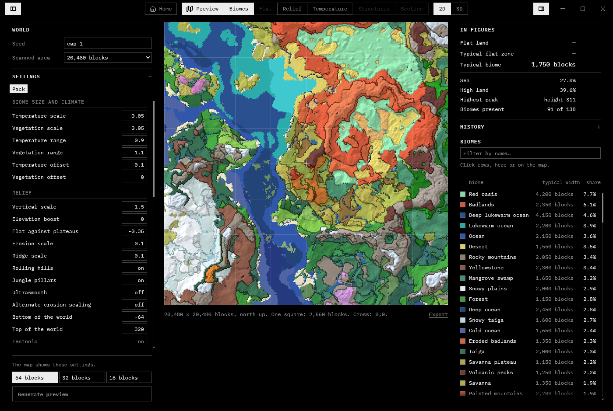 | 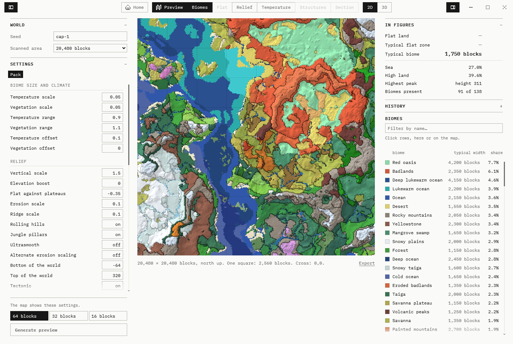 |

## Principles

- **Owned end to end.** No third-party crate except Microsoft's `windows` bindings, and only in the Windows backend. When a problem is already solved elsewhere (Taffy, microui, egui, Clay), the kit reads how and writes its own reduced version.
- **Simple over fine-grained.** It builds the subset its applications use, not the general case: a reduced flexbox and grid, one-line text fields, a vertical scroll area.
- **Every visible state has a picture.** `--shot` draws one frame offscreen into a PNG; the tests compare those frames and write them under `target/tmp`. The pictures below come from there.
- **One system speaks to Windows.** Only `nui-win32` names Windows; the other crates talk to it through the traits of `nui-base`, so another system would replace one crate.
- **Immediate mode.** An application rebuilds its interface every frame from its own state; widgets answer with what happened (`Resp`), and hit tests use the last frame's rectangles.

## Tokens

### Colour

Two layers, as in Figma variables. The palette (`tokens::palette`) holds raw colours: a grey scale from `GREY_0` (white) to `GREY_1000` (black) whose steps are even in perceived lightness, and an amber and a red scale on the same steps. The two themes, `Theme::dark()` and `Theme::light()`, give each role a colour of the palette. An application can follow the system's setting and its changes.

| Role | Used for | Dark | Light |
|---|---|---|---|
| `ground` | the background | grey 1000 | grey 50 |
| `line` | separators and tracks | grey 800 | grey 200 |
| `text` | words and values, the fill of a pressed control | grey 100 | grey 950 |
| `muted` | secondary words, resting icons | grey 400 | grey 600 |
| `edge` | the frame of a resting control | grey 700 | grey 300 |
| `warn` | failures | amber 300 | amber 600 |
| `grid` | lines over a map | white at 16 % | black at 12 % |
| `select` / `select_text` | selected text, the hot row of a menu | grey 700 / `text` | grey 300 / `text` |
| `track` | a slider's track (no widget paints it) | grey 600 | grey 400 |

The window's Close button turns red 600 under the pointer, in both themes. Faded states are not new colours: `Theme::faded` mixes a token over the ground, as CSS `opacity` would, at one of four fades: 0.85 for a filled control under the pointer, 0.5 for rows set back, 0.4 for anything disabled, 0.08 for a light fill under the pointer.

### Type

One family, IBM Plex Mono (Regular and SemiBold, shipped in `fonts/` under the SIL Open Font Licence), with Consolas as the fallback. Every glyph advances 0.6 em, so widths are counted in cells, and a wide character takes two.

| Look | Size / line | Weight | Tracking |
|---|---|---|---|
| `body` | 12 / 18 px | Regular | 0 |
| `heading` (uppercased by the caller) | 12 / 15 px | SemiBold | 0.06 em |
| `label` (uppercased by the caller) | 11 / 16.5 px | Regular, muted | 0.08 em |
| `small` | 11 / 16.5 px | Regular | 0 |
| `status` | 11 / 16 px | Regular | 0 |

### Space and size

Every space comes from one scale: 2, 4, 8, 12, 18, 24, 32, 48, 64, 96, 128, 192, 256, used through roles (`INSET_HAIR` 2, `INSET_TIGHT` 4, `INSET` 8, `INSET_WIDE` 12 inside a control; `GAP_TIGHT` 4, `GAP` 8, `GAP_WIDE` 12 between elements; `SECTION` 24, `REGION` 48). Sizes sit on a 4 px grid: icons 16, compact controls and menu rows 24, controls 28, square icon buttons 32, the main button 36, the bar 40, window buttons 48 wide. All of them are in `crates/nui-ui/src/tokens.rs`, the same values as the design system's tokens.

Lines are 1 logical pixel at every display scale, drawn inside their box. The scroll area keeps a 12 px gutter with a 1 px track, a 4 px thumb (at least 16 px long) and a 12 px arrow at each end that has content beyond it; the wheel moves 100 px. Window grips are 5 px, 8 px at the corners.

### Motion

One ease, CSS's `cubic-bezier(.25, .1, .25, 1)`, and one slide of 220 ms. When Windows' "Animation effects" are off, a slide jumps. Tooltips wait 0.5 s.

## Components

Buttons (filled, held, disabled, underlined), the toggle, labels and wrapped text, the ellipsis, folds, the tab strip and its menu, choices and details, the select and its menu, the text field and the number field (focus, caret, selection, clipboard, the input method's composition), the scroll area, list rows and their legend, trend rows, icon and tool buttons, tooltips, cursors, and the window's own frame (its buttons and grips).

| Dark | Light |
|---|---|
| 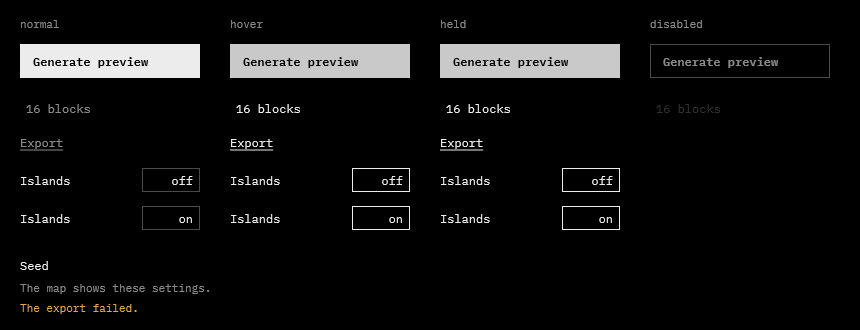 | 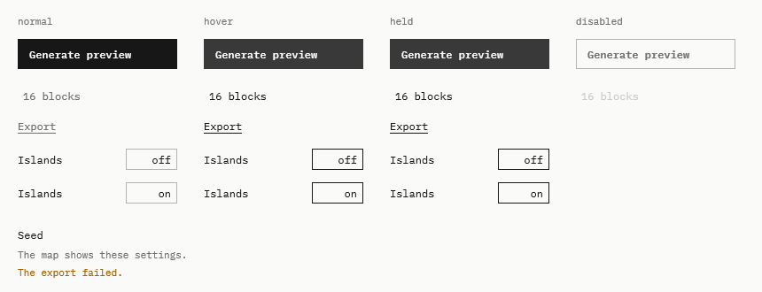 |
| 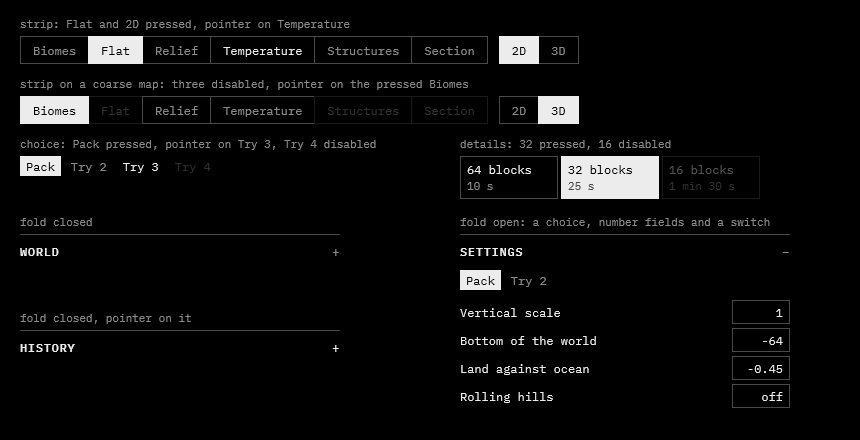 | 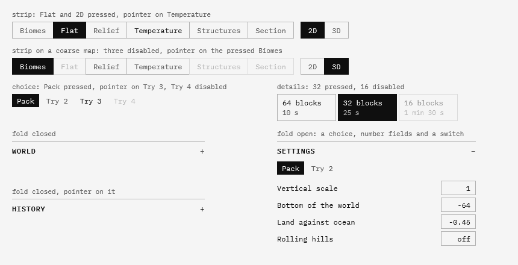 |
| 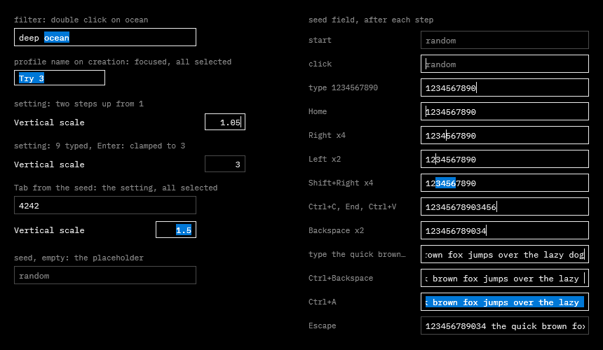 | 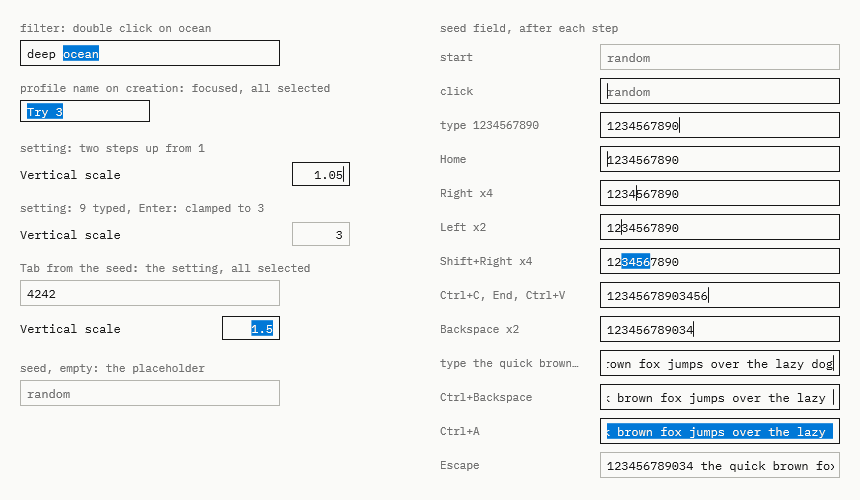 |
| 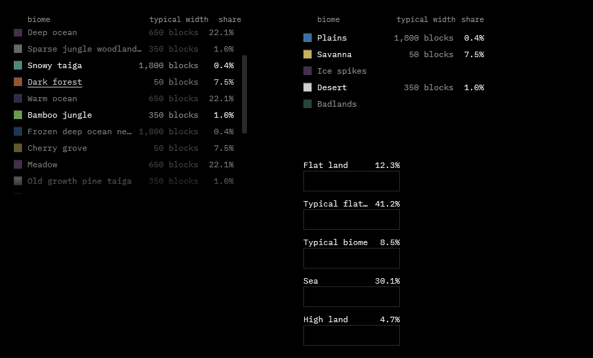 | 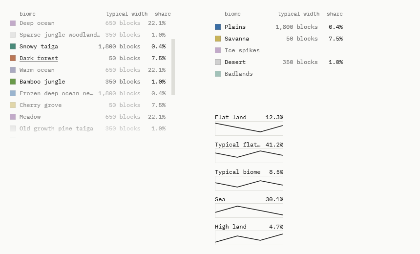 |
| 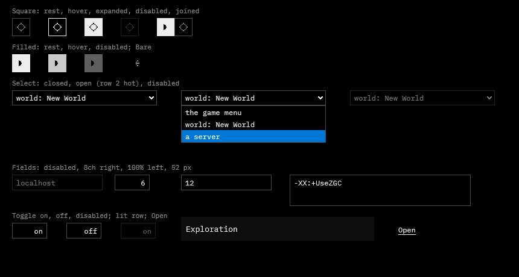 | 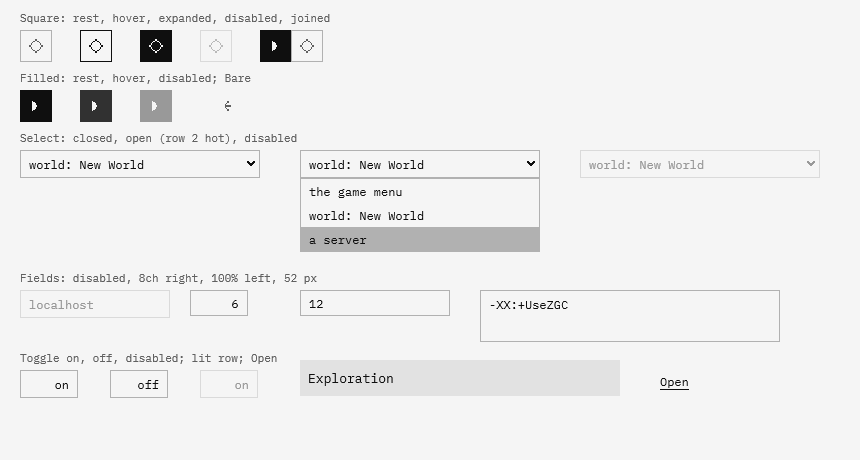 |
| 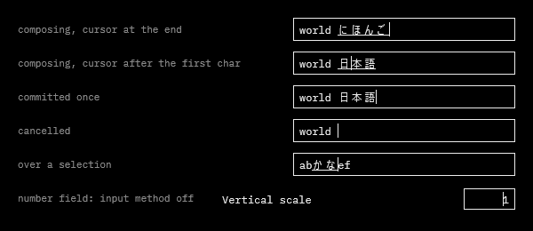 | 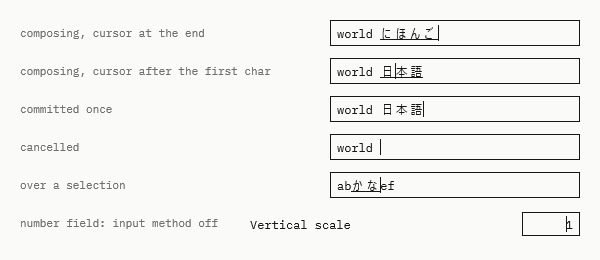 |

## Crates

| Crate | What it holds |
|---|---|
| `crates/nui-base` | Geometry, colours, matrices, the orbit camera, draw lists, the `Gfx` and `App` traits, events, the log hub. No system code, no dependency. |
| `crates/nui-layout` | Pure layout: a reduced flexbox and grid, absolute boxes, overflow, measured leaves, a debug dump. |
| `crates/nui-ui` | The immediate-mode components and the tokens above. Depends on `nui-base` and `nui-layout` only. |
| `crates/nui-win32` | The Windows backend: a Win32 window with its own frame, Direct3D 11 for meshes, Direct2D and DirectWrite for the interface, offscreen pictures, the system's theme and motion settings, the input method, a launcher for child processes. |
| `crates/nui-png` | A PNG writer and a reader for the files it writes, for picture tests. |
| `demos/widgets` | Every component in its states, live (`--controls`, `--fields`, `--lists`, `--launcher`) or as a sheet (`--shot`). |
| `demos/preview` | The world preview, the kit's largest application. |
| `demos/relief`, `demos/shell-boxes` | The preview's 3D scene alone, and its page laid out as named boxes. |

## Build and test

Windows with Direct3D 11.1 and Direct2D, and a stable Rust that knows edition 2024.

```
cargo test --workspace
cargo run -p widgets -- --controls
```

The tests write their pictures under `target/tmp`. Those that need a world preview's out folder read the one `PREVIEW_DATA_DIR` names, and those that compare with the preview's web page find it in `WORLD_PREVIEW_DIR` (the `world-preview` repository); without them, they say "skipped".

## Status

Windows only, and not on crates.io: the crates are consumed by path. `docs/design.md` is the design dossier and `GLOSSARY.md` the project's words.

## Licence

GPL-3.0-only, see `LICENSE`. IBM Plex Mono is under the SIL Open Font Licence (`fonts/OFL.txt`); the preview's bar icons are drawn after Pixelarticons, under MIT (`demos/preview/THIRD-PARTY.md`).
