# mere-ui

A small native interface kit for Windows, written in Rust and drawn with Direct2D and DirectWrite. It is read as a design system: a short list of tokens (colours, type, sizes, motion), a set of components built from them, and pictures of every component in both themes, taken offscreen by the tests from the same frame the window shows.

It grows piece by piece as its applications need it. Its applications are a world preview for a Minecraft server's terrain and the launcher of Outpost Tools, both in their own repository, `outpost-tools`.

`mere` names a family of base libraries written with nothing borrowed: this kit is `mere-ui`, and its crates are `mere-base`, `mere-layout`, `mere-ui`, `mere-win32` and `mere-png`. Until 0.11.0 it was called `rust-native-ui`, with crates named `nui-*`.

| Dark | Light |
|---|---|
| 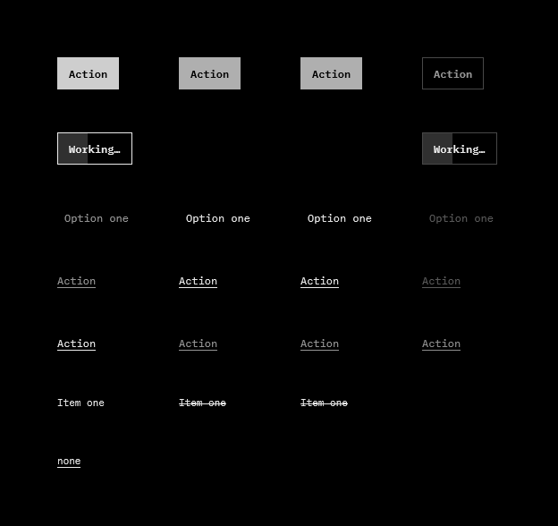 | 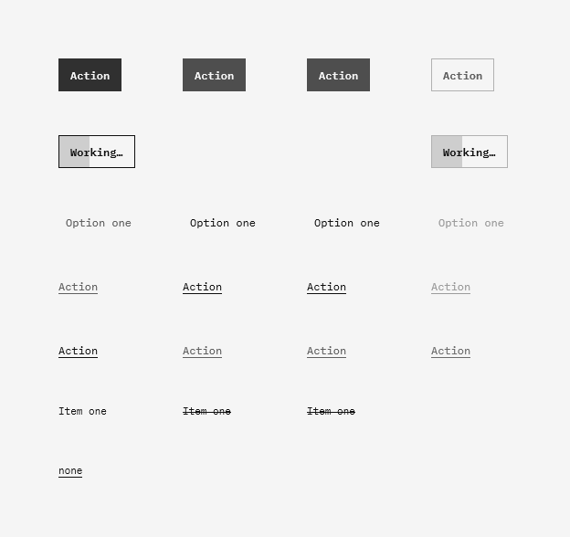 |
| 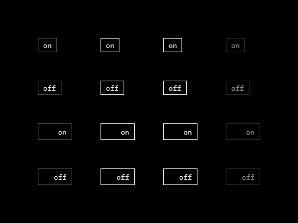 | 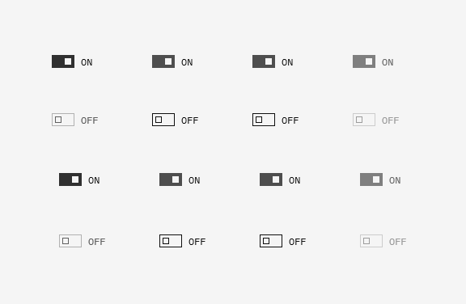 |
| 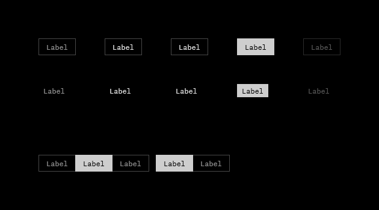 | 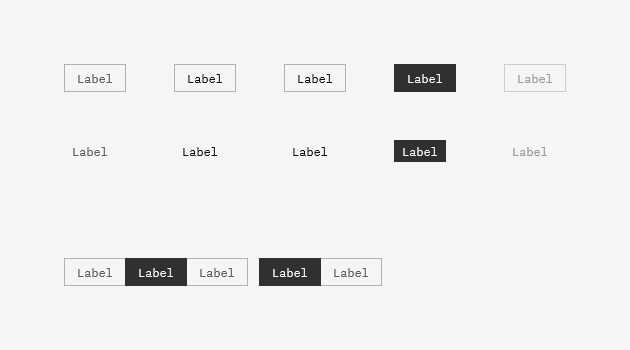 |
| 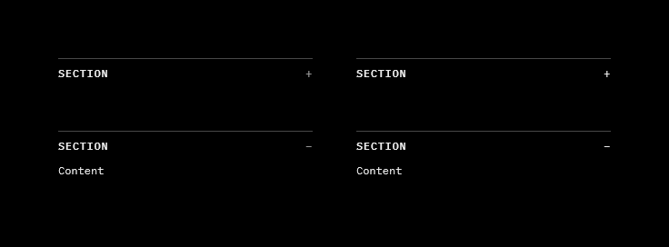 | 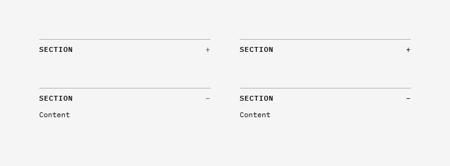 |
| 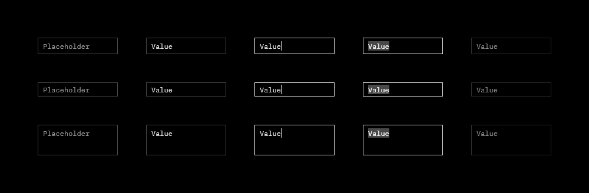 | 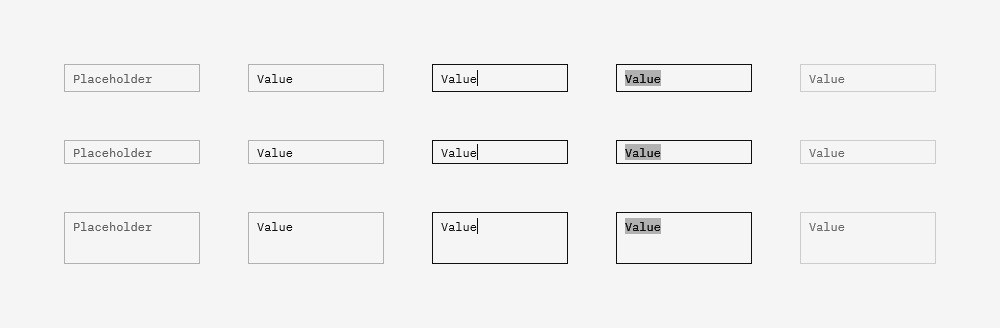 |
| 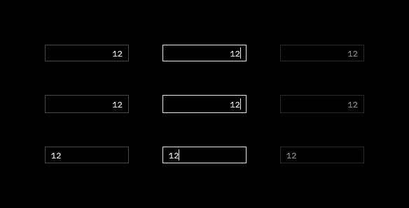 | 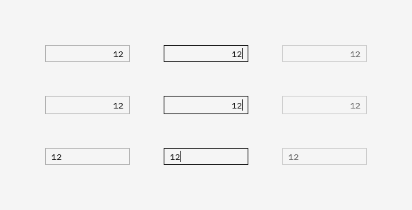 |
| 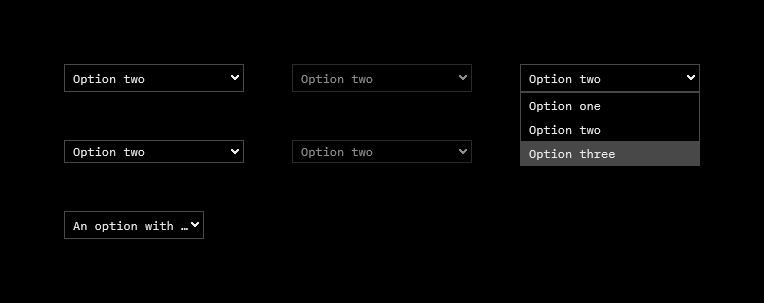 | 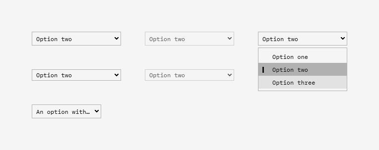 |
| 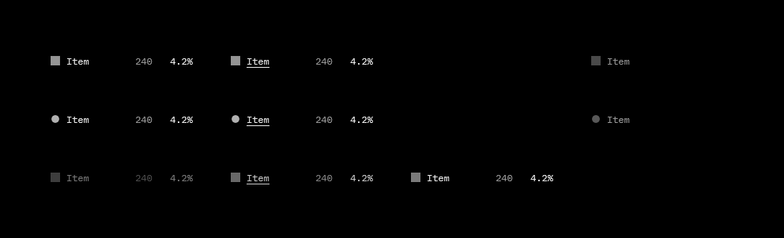 | 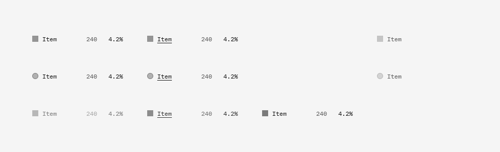 |
| 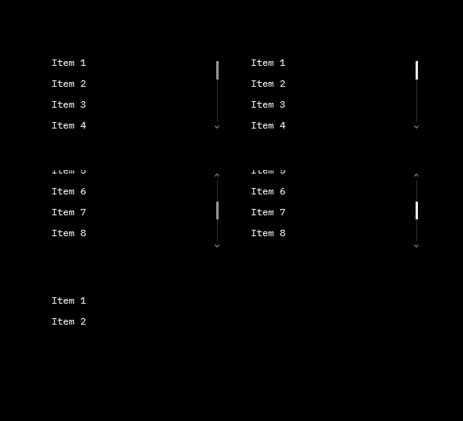 | 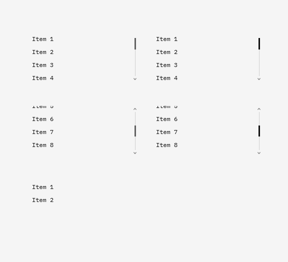 |
| 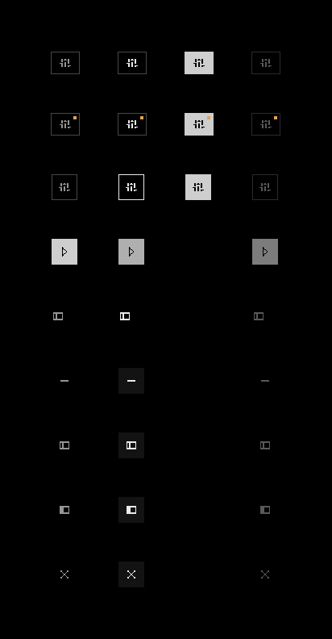 | 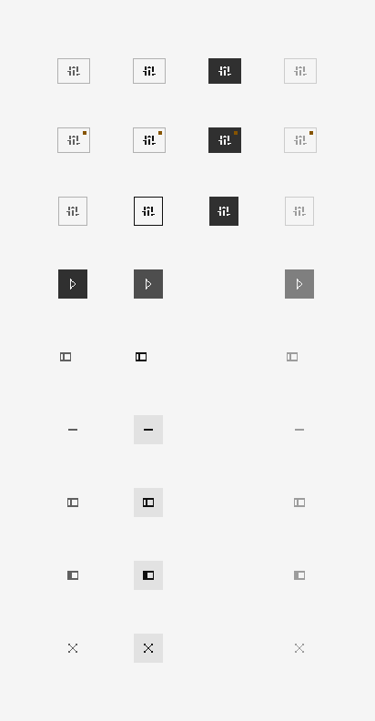 |
| 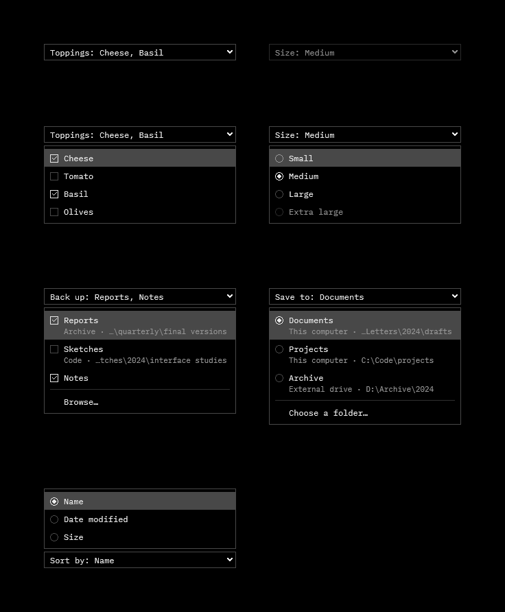 | 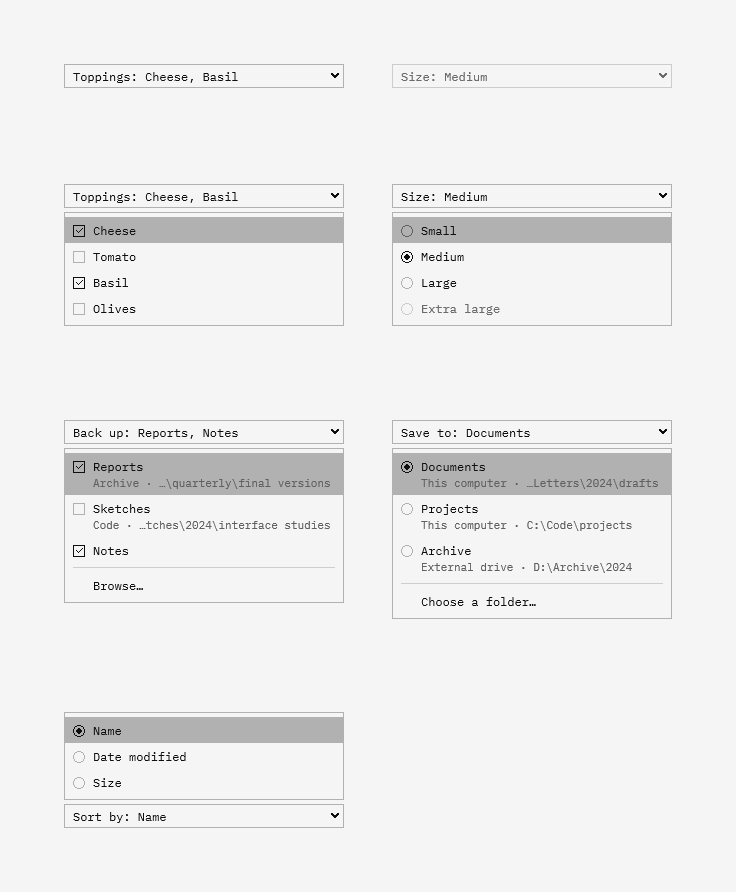 |

Each picture is a card: one component in its variants, the same as the Design System's preview of it. `cargo test -p widgets` writes all twenty-four, in both themes, as `target/tmp/card_<name>_<theme>.png`; `docs/shots/card-*.png` are copies.

## Crates

| Crate | What it holds |
|---|---|
| `crates/mere-base` | Geometry, colours, matrices, the orbit camera, draw lists, the `Gfx` and `App` traits, events, the log hub. No system code, no dependency. |
| `crates/mere-layout` | Pure layout: a reduced flexbox and grid, absolute boxes, overflow, measured leaves, a debug dump. |
| `crates/mere-ui` | The immediate-mode components and the tokens above. Depends on `mere-base` and `mere-layout` only. |
| `crates/mere-win32` | The Windows backend: a Win32 window with its own frame, Direct3D 11 for meshes, Direct2D and DirectWrite for the interface, offscreen pictures, the system's theme and motion settings, the input method, a launcher for child processes. |
| `crates/mere-png` | A PNG writer and a reader for the files it writes, for picture tests. |
| `demos/widgets` | One card per component of the Design System, in a window (`--card NAME`) or as a picture (`--shot`). |
| `demos/shell-boxes` | The world preview's page laid out as named boxes. |

The world preview's window and the relief demo now live in the outpost-tools repository (https://github.com/louisfifre/outpost-tools, folders `preview/` and `relief/`), which depends on this kit by git tag.

## Build and test

Windows with Direct3D 11.1 and Direct2D, and a stable Rust that knows edition 2024.

```
cargo test --workspace
cargo run -p widgets -- --card button
```

The tests write their pictures under `target/tmp`.

## Status

Windows only, and not on crates.io: the crates are consumed by git tag (outpost-tools pins one, so renaming a crate is a breaking change for it at its next pin). `docs/design.md` is the design dossier and `GLOSSARY.md` the project's words.

## Licence

GPL-3.0-only, see `LICENSE`. IBM Plex Mono is under the SIL Open Font Licence (`fonts/OFL.txt`); the icon paths of the tests and the cards are drawn after Pixelarticons, under MIT (`THIRD-PARTY.md`).
